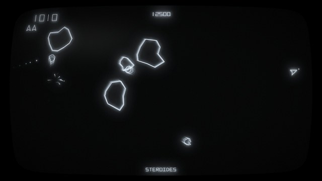

# Stéroïdes CRT — fond d'écran animé pour Lively Wallpaper

Fond d'écran animé pour [Lively Wallpaper](https://github.com/lively-community/lively) (Windows), dans l'esprit des bornes d'arcade vectorielles de 1979 : écran noir, rochers filaires à la dérive, vaisseau triangulaire tracé au faisceau lumineux, et rendu fidèle d'un tube cathodique (halo, rémanence du phosphore, verre bombé, reflet).

Une partie se joue toute seule en démonstration : le vaisseau pivote, accélère et tire, les rochers se brisent en morceaux de plus en plus petits, une sonde ennemie traverse l'écran en zigzag, et les vagues s'enchaînent.

Rochers, vaisseau, sonde et nom « Stéroïdes » sont des créations originales.

## Installation

1. Télécharger `Steroides_CRT_Lively.zip` dans **Releases** (colonne de droite de cette page), sous « Assets ».
2. Le faire glisser dans la fenêtre de Lively Wallpaper.
3. Cliquer sur la vignette « Stéroïdes CRT » pour l'appliquer.

## Réglages

Clic droit sur le fond dans Lively, puis **Personnaliser** :

| Réglage | Effet |
|---|---|
| Affichage | Étiré sur tout l'écran, ou centré (écran de borne 4:3) |
| Luminosité | 10 à 200 % |
| Halo lumineux | Intensité de la lueur autour du tracé (0 à 200 %) |
| Rémanence du phosphore | Longueur des traînées laissées par les objets (0 à 100 %) |
| Courbure du tube | De plat à très bombé |
| Couleur du tracé | Blanc bleuté par défaut (essayez le vert ou l'ambre) |
| Reflet sur la vitre | Activé / désactivé |
| Titre en bas de l'écran | Affiché / masqué |
| Vitesse du jeu | 25 à 200 % |

Fonctionne à toutes les résolutions (testé en 2560×1440). Comme tout fond Lively, l'animation se met en pause quand un jeu ou une application passe en plein écran.

## Fichiers

- `index.html` — le jeu et l'effet cathodique (WebGL)
- `LivelyInfo.json` — description du fond pour Lively
- `LivelyProperties.json` — les réglages
- `thumbnail.jpg` — la vignette
- `Steroides_CRT_Lively.zip` — les 4 fichiers ci-dessus, prêts à glisser dans Lively (aussi disponible dans Releases)

## Du même auteur

- [Star Sentry CRT](https://github.com/scheeaser-maker/lively-retro-arcade-crt) — borne d'arcade à sprites, avec bande de gélatine verte

---

*Animated vector arcade wallpaper for Lively Wallpaper, with a realistic CRT effect (beam glow, phosphor persistence, curved glass, reflection). Original shapes, self-playing demo. Download Steroides_CRT_Lively.zip from Releases and drag it into Lively to install.*
